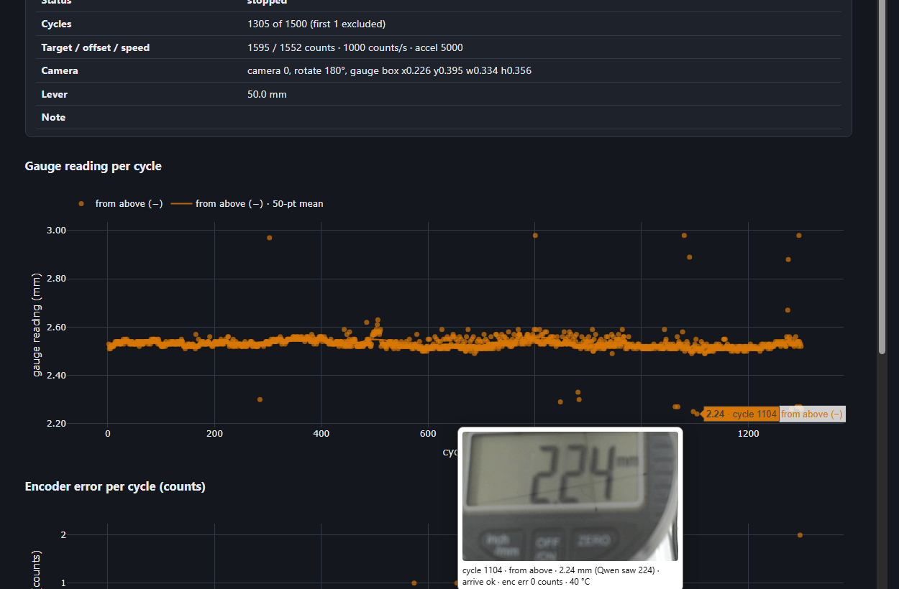
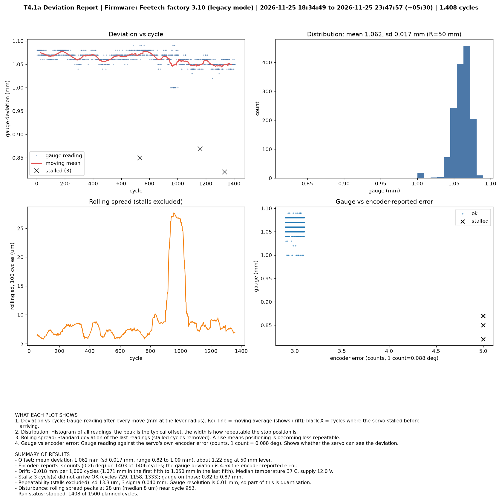

# Portfolio: measuring whether new firmware makes a hobby servo better

*Feetech STS3215 factory firmware vs RoboNine STS32XX firmware, on one servo, with a test bench built for the job. Work of 2026-11-25 to 2026-11-26. Updated by the portfolio skill; the evidence is in [observations/](observations/).*

## The question

The STS3215 is the servo of many low-cost robot arms (SO-ARM100 class). RoboNine published a bench study of it ([article](https://robonine.com/testing-of-feetech-sts3215-servomotor-backlash-repeatability-and-torque/)): **backlash 0.87° against 0.5° in the datasheet**, a **10-count firmware dead zone**, jitter with an extended arm, repeatability about 2 counts. RoboNine also ships its own firmware (v9) with an S-curve / PID controller and says it improves on this.
**Does it?** The only honest way is to flash both firmwares on the *same* servo and measure the *same* things the *same* way.

## What was built

A test bench (`sts3215-repeat-bench`, Python + Flask, runs in its own window) that drives the servo over UART at 1 Mbaud and records everything:

| Capability | Version | What it does |
|---|---|---|
| Repeatability tests T4.1a / T4.2b | 1.x | Move to a target thousands of times, read a digital dial gauge from camera frames with a vision model, log encoder, current, load, voltage, temperature at 20-60 Hz |
| Firmware switching | 1.x | Flash Feetech factory or RoboNine v9 from the bench, with an automatic backup of the servo settings; restore from a backup |
| Interactive reports | 1.6.0 | plotly charts; **hover a point and see the camera picture taken at that moment** |
| Hold & PID test | 1.7.0 | Hold with torque on, step ± counts, measure rise / overshoot / settling, jitter |
| Report library | 1.8.0 | `00_library.html`: every report in one searchable page, sorted by kind |
| T3 backlash push test | 1.9.0 | Guided free-play test with encoder + gauge (hidden until the gauge is used again) |
| **Auto test (T3.1)** | 1.10.0 | One click after homing, about 5 minutes, **no gauge**: command dead zone (1-15 count reversing steps), hysteresis from below / above, hold jitter, from the set value and the current value only |

Engineering choices worth noting: test IDs follow the published plan instead of inventing new ones; the bench logs every poll and saves every frame so any number can be traced to a picture; a temperature limit acts only on confirmed readings after sensor glitches stopped runs; reports link frames relatively so they work offline.

*Hovering one of the 21 outliers of the RoboNine extension run: the saved gauge picture really shows 2.24 mm, with the encoder at 0 counts of error.*

## Results so far (one servo, 50 mm lever, preliminary)

| | Feetech factory 3.10 (legacy) | RoboNine v9, extension | RoboNine article (stock) |
|---|---|---|---|
| Longest run | **1,408 cycles**, 5 h 13 min | **1,305 cycles**, 5 h 20 min | n/a |
| Encoder error after arrival | **+3.00 counts** on 99.8 % of cycles | **0.00 ± 0.08 counts** | ≈ 2 counts |
| Typical gauge spread (robust SD) | 0.0148 mm | 0.0148 mm | ±0.3 mm (different method) |
| Large excursions (> 0.1 mm) | 3 of 1,406 (0.2 %) | **21 of 1,299 (1.6 %)** | n/a |
| Stalled arrivals | 3 of 1,406 | 0 of 1,303 | n/a |
| Dead zone (T3.1) | **to be measured** | **to be measured** | 10 counts |
| Backlash (T3) | to be measured | to be measured | 0.87° |

Findings, each with its evidence in the observation log:
* **The RoboNine controller removes the steady +3-count offset** the stock firmware leaves (OBS-002).
* **On what the gauge can resolve, the two firmwares have the same spread** (OBS-001).
* **The extension run shows more large excursions of the output while the encoder reads zero error**: 0.2-0.45 mm, 0.25-0.5° at 50 mm, the size of the datasheet backlash. This fits play inside the gearbox that the encoder cannot see (OBS-003); one of the 21 was checked by eye and is real (OBS-004).
* **The first-run gauge offset (1.06 mm) is not backlash**: the gauge zero is arbitrary (OBS-005).
* Nothing yet answers the article's two headline claims: that needs the Auto test and the push test (next).

*Report of the 1,408-cycle Feetech run: deviation per cycle, distribution, rolling spread, gauge vs encoder.*

## Incidents handled (and what they changed)

* **Servo bricked by a firmware upgrade tool** (settings area erased to 0xFF; 0 V / 10 °C with the supply on). Diagnosed from the symptoms, recovered with the bootloader and a settings backup the bench had taken, and turned into rules: flash only from the bench; "0 V with power on = wiped settings".
* **Sensor glitches** (single 76 / 150 °C reads) stopped tests; fixed by acting only on confirmed readings.
* **An editing mistake:** a text patch deleted twelve routes from the bench; rebuilt from a compiled `.pyc` and verified to compile to identical bytecode; the lesson is in the project memory.
* **A wrong inference** (a firmware "local build" from its label) was found and corrected in the notes instead of left in place.

## How Claude is used in this project

The repository carries Claude Code project memory and skills so any session can pick up exactly where the last one stopped:

* `CLAUDE.md`: goal, layout, hard rules, current state.
* `.claude/skills/operator`: guides the human through a test session (preflight, condition, tab, parameters, stop rules); never presses hardware buttons.
* `.claude/skills/observer`: analyses new runs, checks comparability, writes evidence-linked observations (OBS-nnn) and the comparison matrix.
* `.claude/skills/portfolio`: keeps this page and the notebook current and pushes when asked.
* `.claude/skills/servo-recovery`: the recovery procedure above.
* `.claude/agents/operator.md`, `observer.md`: read-mostly sub-agents for the two roles.

## Status and next steps

| Done | Next |
|---|---|
| Bench v1.10.0 (reports, hold, Auto test); T4.1a on F and RE; reference article read and mapped to tests; notebook, skills and memory in place | **Auto test in RE, RL, F, F2** (dead zone, hysteresis, jitter) → T4.2b → 100-cycle RL and F2 with the same set-up → T3 once with the 20 × 20 beam (near vertical, gauge near the axis) → the decision written in the comparison file |

Limits: one servo (unit-to-unit spread is real), vision-read gauge at 0.01 mm, runs on different days with the gauge re-zeroed. The notebook lists what would change these conclusions.

*Repository: this folder. Notebook: [observations/README.md](observations/README.md). Test plan: `docs/TEST-PLAN.md` in the project folder. Bench notes: [docs/NEXT-VERSION.md](docs/NEXT-VERSION.md).*
